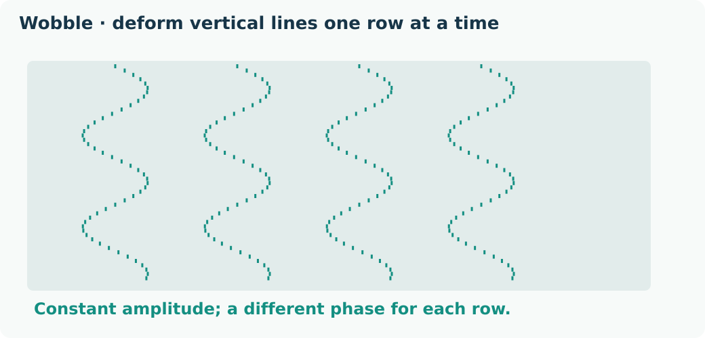

# wobble — Give each row an oscillating position

*[Español](README.md)* · **Lesson 5 of 10** · [Source](../../../../demos/wobble/wobble.c) · [Shared foundations](../../BASES-EN.md)




*A continuous illustration of the shape; the source samples an integer table.*

## What you will learn

Separate wave amplitude, spatial density and temporal speed while reusing scroll's two-copy row renderer.

```text
shift(y,t) = sine(phase(t) + y*density) * amplitude /256
amplitude =24
density =3 phases per row
next phase =phase+4
```

Amplitude controls horizontal range. Density controls variation between rows. Speed controls variation between frames. Unlike stripes, wobble computes the complete displacement directly; it does not accumulate a velocity into a row position.

## Calculate one frame

Temporarily use density 1 and phase 0 to isolate the arithmetic:

| Row | Sampled phase | Sine | Shift |
|---:|---:|---:|---:|
| 0 | 0 | 0 | 0 |
| 64 | 64 | 256 | +24 |
| 128 | 128 | 0 | 0 |
| 192 | 192 | −256 | −24 |

At the actual density 3, continuous wavelength is `256/3≈85.33` rows, or about 2.34 cycles across 200 rows. Density 1 shows less than one full cycle vertically.

Adding 4 to phase repeats after 64 frames, about 0.91 seconds at sustained 70 fps. Quantisation may repeat particular shifts sooner, but the phase period remains 64.

## Convert negative shifts to circular offsets

Two-copy rendering expects 0–319. Shift−5 is equivalent to+315 for a 320-pixel circular row:

```c
if (shift < 0) {
    shift = shift + DEMO_WIDTH;
}
```

At amplitude 24, one addition is sufficient. Larger amplitudes require checking both the wrapping range and the earlier multiplication.

## Two independent numeric limits

The sine product reaches 6144 at amplitude 24 and 20480 at amplitude 80; both fit signed 16-bit arithmetic. At amplitude 128 it can reach 32768 and overflow. Being smaller than the screen width does not make the product safe.

Widening the product to `long` enables further experiments, but offsets still need correct normalisation before the two copies.

## Cost and a useful control experiment

Each frame uses 200 sine lookups,200 shifts and 400 span copies covering 64000 bytes. `demo_show` adds VGA presentation and audio service.

Remove Y from the sine phase and every row moves equally: the result is a horizontal oscillating translation. This demonstrates that spatial dependence creates the wave, rather than the mere presence of a sine function.

## Workshop with answer

**Predict:** amplitude 24, sine−128. **Answer:** shift−12, wrapped offset 308; the row moves 12 pixels left.

**Practice:** independently try amplitude 24→48, density 3→1 and speed 4→2. Expect twice the range, a longer wave and twice as many frames per period. Restore each parameter before changing the next.

**Extension:** vary amplitude from zero at the top to 24 at the bottom. This prepares ripple's spatial attenuation; widen intermediate products when the new ranges require it.

---

[Previous: stripes](../../stripes/doc/README-EN.md) · [Next: bounce](../../bounce/doc/README-EN.md) · [Index](../../README-EN.md)
