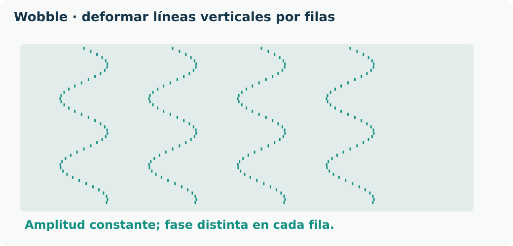

# wobble — Hacer que cada fila ocupe otra posición

*[English](README-EN.md)* · **Lección 5 de 10** · [Código](../../../../demos/wobble/wobble.c) · [Bases comunes](../../BASES.md)




*Esquema continuo para leer la forma de la onda; la implementación usa la tabla entera.*

## Lo que vas a aprender

Separar amplitud, densidad espacial y velocidad temporal de una onda. Reutilizarás las copias de scroll, pero calcularás la posición directamente en cada frame.

## Una fórmula con tres controles

```text
shift(y,t) = seno(phase(t) + y*density) * amplitude / 256
amplitude = 24
density = 3 fases por fila
phase siguiente = phase + 4
```

La amplitud decide el recorrido horizontal máximo. La densidad decide cuánto cambia la onda al bajar una fila. La velocidad decide cómo evoluciona entre fotogramas. Aumentar uno no equivale a aumentar los otros.

No hay un offset acumulado por fila como en stripes. Cada fila vuelve a calcular su desplazamiento completo a partir de fase e Y. Por eso su recorrido queda siempre dentro de ±24.

## Calcular una instantánea

Para aislar las cuentas, usa densidad 1 y fase 0 en una copia de prueba:

| Fila | Fase consultada | Seno | Desplazamiento |
|---:|---:|---:|---:|
| 0 | 0 | 0 | 0 |
| 64 | 64 | 256 | +24 |
| 128 | 128 | 0 | 0 |
| 192 | 192 | −256 | −24 |

Al volver a densidad 3, la longitud de onda continua es `256/3 ≈ 85,33` filas. Sobre 200 filas caben unas 2,34 ondas. Densidad 1 produce menos de una vuelta completa en la altura visible, no necesariamente una onda entera.

La fase temporal suma 4: el estado de fase se repite cada 64 frames, alrededor de 0,91 s si se sostienen 70 fps. La cuantización puede repetir algunos desplazamientos antes, pero no cambia ese periodo de fase.

## Convertir desplazamientos negativos en rotaciones de fila

El motor de dos copias espera un offset entre 0 y 319. Un desplazamiento−5 equivale a+315 al envolver una fila de 320:

```c
if (shift < 0) {
    shift = shift + DEMO_WIDTH;
}
```

Después se copian los dos segmentos como en scroll. Con amplitud 24 una sola suma basta. Una amplitud mayor requiere comprobar tanto el rango del desplazamiento como el producto anterior.

## Dos límites diferentes

`seno*24` alcanza 6144 y cabe en `int`. Con amplitud 80 alcanza 20480 y también cabe. Con amplitud 128 puede llegar 32768 y exceder el máximo con signo. Que 128 sea menor que la anchura 320 no evita ese desbordamiento.

Si ensanchas el producto a `long` para explorar amplitudes grandes, todavía debes normalizar correctamente el resultado al rango de las copias. Resolver el tamaño numérico no resuelve automáticamente el wrap.

## Trabajo por frame

200 consultas de seno,200 desplazamientos y 400 copias que cubren 64000 bytes. La tabla evita calcular trigonometría en tiempo real. `demo_show` añade presentación y servicio de audio.

Con fase independiente de Y todas las filas se mueven igual: queda una traslación horizontal oscilante. Esta prueba demuestra que la ondulación nace de la dependencia espacial, no simplemente de «usar un seno».

## Taller con respuesta

**Predice:** amplitud 24, seno−128. **Respuesta:** desplazamiento−12, offset envuelto 308. La imagen de esa fila se mueve 12 píxeles a la izquierda.

**Práctica:** cambia por separado amplitud 24→48, densidad 3→1 y velocidad 4→2. Espera, respectivamente, el doble de recorrido, una onda más larga y el doble de frames por periodo. Devuelve el valor anterior antes del siguiente cambio.

**Ampliación:** haz que la amplitud crezca desde cero en la fila superior hasta 24 abajo. Eso prepara la atenuación espacial de ripple. Ensancha productos cuando el nuevo rango lo necesite.

---

[Anterior: stripes](../../stripes/doc/README.md) · [Siguiente: bounce](../../bounce/doc/README.md) · [Índice](../../README.md)
