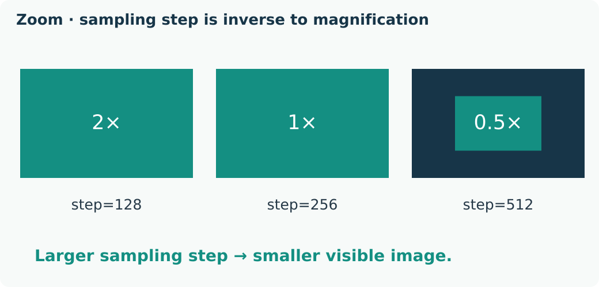

# zoom — Find the source of every screen pixel

*[Español](README.md)* · **Lesson 9 of 10** · [Source](../../../../demos/zoom/zoom.c) · [Shared foundations](../../BASES-EN.md)




*The sampling step has eight fractional bits; 256 represents one.*

## What you will learn

Inverse sampling, centred scaling and a reusable column table.

Pushing each source pixel to one enlarged destination position leaves holes. Inverse sampling visits each destination and asks which source position it should read.

```text
source step0.5: 0 0 1 1 2 2 → repeated samples, larger image
source step1:   0 1 2 3 4 5 → identity
source step2:   0 2 4 6 8...→ skipped samples, smaller image
```

The scale variable is an **inverse sampling step**. Larger values shrink the displayed image; ideal magnification is 1/step.

## Keep the centre fixed

For centre `(160,100)` and real step S:

```text
u=160+(x-160)*S
v=100+(y-100)*S
```

Fixed-point step 256 represents 1. The source corner is computed in `long` as `(160<<8)-step*160`, and similarly for Y. Add step for each destination column/row.

Step 256 yields identity. Step 128 begins at source `(80,50)` and doubles the central image. At step 512, `u=2*x-160` and `v=2*y-100`: valid destination columns are 80..239 and rows 50..149. The visible image is 160 ×100 with black outside.

## Reuse horizontal answers

Without rotation, source X depends only on destination X. A 320-entry `unsigned int` table costs 640 bytes and supplies the same source columns for every row:

```c
for (x = first; x <= last; x++) {
    screen[destination + x] = image[source_row + column[x]];
}
```

Precalculation also discovers first/last valid columns. Invalid entries are never consumed. Entire invalid rows are filled black; valid rows combine black borders with sampled pixels.

The unsigned comparison rejects negative and excessive source coordinates before indexing. It does not make an invalid coordinate safe to use as a pointer.

## Exact constants and limits

The midpoint is 358 and amplitude 204, giving fixed-point steps 154..562, approximately 0.60156..2.19531. These are sampling steps, not direct magnification factors.

The minimum-step clamp avoids visual degeneracy. A zero step would sample the same central coordinate everywhere; this sampler would not divide by zero.

## Cost and image quality

The table requires 320 horizontal transformations per frame, followed by up to 64000 visible samples and black fills. It removes repeated horizontal arithmetic, not screen writes.

There is no filtering. Thin lines can disappear during reduction; averaging colours would need more work and a method for mapping results back to palette indices.

## Workshop with answer

**Predict:** step 128, destination `(10,20)`. **Answer:** source `(85,60)`.

**Practice:** disable breathing amplitude and test steps 256,128 and 512: identity, doubled centre and 160 ×100 reduction. Use a grid to expose centre and clipping errors.

**Extension:** move the zoom centre. Derive the new source corner and identify the point that remains fixed. Horizontal results remain reusable between rows while there is no rotation.

---

[Previous: mosaic](../../mosaic/doc/README-EN.md) · [Next: rotozoom](../../rotozoom/doc/README-EN.md) · [Index](../../README-EN.md)
