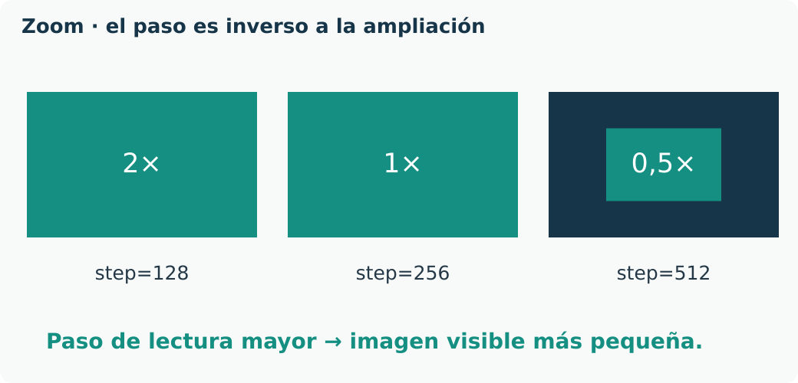

# zoom — Buscar el origen de cada píxel de pantalla

*[English](README-EN.md)* · **Lección 9 de 10** · [Código](../../../../demos/zoom/zoom.c) · [Bases comunes](../../BASES.md)




*El paso se expresa con ocho bits fraccionarios: 256 significa una muestra por píxel.*

## Lo que vas a aprender

Muestreo inverso, escala como paso de lectura, transformación respecto al centro y precálculo de las columnas que se repiten en todas las filas.

## Por qué se recorre el destino

Si amplías un píxel del origen enviándolo a una única posición de destino, quedan huecos. El muestreo inverso recorre todas las posiciones de destino y pregunta de dónde viene cada una.

```text
paso de origen 0,5:  0 0 1 1 2 2 3 3 → repite muestras, amplía
paso de origen 1:    0 1 2 3 4 5 6 7 → identidad
paso de origen 2:    0 2 4 6 8 10 ...  → salta muestras, reduce
```

La variable llamada escala es un **paso inverso de muestreo**. Un valor mayor hace más pequeña la imagen visible. La ampliación geométrica ideal es 1/paso.

## Mantener el centro

En unidades reales, con centro `(160,100)` y paso S:

```text
u = 160 + (x-160)*S
v = 100 + (y-100)*S
```

En punto fijo, el paso 1 se guarda como 256:

```c
start_u = ((long)160 << DEMO_SHIFT) - step * 160;
start_v = ((long)100 << DEMO_SHIFT) - step * 100;
```

Después se suma `step` por columna y fila. Con step 256, el primer origen es `(0,0)` y cada píxel coincide con el original. Con step 128, la esquina de destino lee `(80,50)` y el centro se amplía al doble.

## Un caso de reducción completo

Con step 512, S=2:

```text
u = 2*x - 160
v = 2*y - 100
```

Se exige 0≤u<320 y 0≤v<200. Las columnas visibles son 80..239 y las filas 50..149:160×100 píxeles. El resto queda negro. La imagen original entera se reduce a la mitad por eje, muestreando una fila y columna de cada dos.

## La tabla de columnas

Sin rotación, la X de origen depende solo de la X de pantalla. Se calcula una vez una tabla de 320 entradas `unsigned int`,640 bytes en este entorno. Cada fila reutiliza esas columnas:

```c
for (x = first; x <= last; x++) {
    screen[destination + x] = image[source_row + column[x]];
}
```

El precálculo también descubre `first` y `last`. Las columnas que están fuera nunca se leen de la tabla. Una fila de origen inválida se resuelve con un relleno completo; una válida usa dos bordes negros y el tramo de muestras.

La comparación `(unsigned int)sx < 320` rechaza negativos y valores grandes en una sola comparación bajo los rangos de este algoritmo. No convierte una coordenada inválida en una dirección utilizable: se comprueba **antes** de indexar.

## Escala real de las constantes

`ZOOM_SCALE_MID=(256*7)/5=358` y `ZOOM_SCALE_AMP=(256*4)/5=204`. Por tanto, el paso nominal recorre 154..562, aproximadamente 0,60156..2,19531; no son exactamente 0,6 y 2,2 ni factores directos de ampliación.

El clamp mínimo 32 evita una degeneración visual. Con paso cero no hay división por cero en este muestreador: todos los destinos leerían la misma coordenada central y saldría un color uniforme. El código evita ese caso por diseño.

## Trabajo y calidad de imagen

Se hacen 320 cálculos de columna por frame y hasta 64000 lecturas de muestras visibles, además de rellenos. La tabla elimina repetir transformaciones horizontales por cada fila, no elimina el trabajo de escribir la pantalla.

La muestra se toma sin filtrado. Al reducir pueden desaparecer líneas finas y aparecer patrones; promediar colores sería otra técnica con más coste y problemas de conversión a paleta.

## Taller con respuesta

**Predice:** step 128, destino `(10,20)`. **Respuesta:** origen `(85,60)`. Dos destinos vecinos pueden seleccionar la misma columna entera.

**Práctica:** anula la amplitud y prueba pasos 256,128 y 512. Verifica identidad, ampliación central y rectángulo reducido 160×100. Usa una cuadrícula para detectar errores de centro o un índice fuera de rango.

**Ampliación:** desplaza el centro de zoom. Deriva primero el origen de la esquina y comprueba qué punto permanece fijo al cambiar S. La tabla sigue siendo reutilizable entre filas mientras no haya giro.

---

[Anterior: mosaic](../../mosaic/doc/README.md) · [Siguiente: rotozoom](../../rotozoom/doc/README.md) · [Índice](../../README.md)
